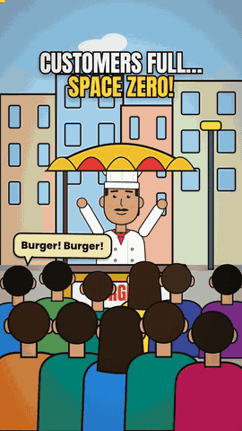

<p align="center">
  
</p>

<h1 align="center">ToonReel</h1>
<p align="center"><b>Write a skit. Get a 2D cartoon reel.</b><br/>
A free, open-source skill for AI agents (Claude Code, Codex, Gemini CLI, Cursor…) that turns a script into a 1080×1920 reel for Instagram, YouTube Shorts and TikTok.</p>

<p align="center">
  <a href="https://someshthakur.tech/toonreel/"><b>Try the studio in your browser →</b></a>
</p>

---

## What you get

- **Original flat-2D characters** with lip-sync driven by the real voice: suits, chefs, kurtas, hoodies, caps, buns, glasses, cheering, jumping, pointing.
- **Free voices** in 400+ languages and accents (Microsoft Edge neural voices, or Kokoro offline). Hindi, Hinglish and Indian English sound great.
- **Five sets:** street shop with a rolling shutter, food cart in the rain, game-show studio, railway station with a passing train, crowded living room.
- **Crowds** that chatter and cheer, comic speech bubbles, confetti, rain, a magic "poof" entrance, camera dives.
- **Your footage or photos** on a "live tour" screen, with stickers, price cards, game-show quiz boards and an end card.
- **Word-by-word captions**, coloured per speaker, kept out of the Instagram UI zones.
- **Pronunciation check:** every line is voiced and transcribed back with Whisper before rendering, so mangled words get caught.
- Also: captions + silence cuts for your own talking videos, and cinematic stories from AI clips.

No subscription, no watermark, runs on your computer.

## Install

You need **Python 3.10+**, **Node 18+** and **ffmpeg** (`winget install Gyan.FFmpeg`, `brew install ffmpeg`, `apt install ffmpeg`).

**Claude Code**
```bash
git clone https://github.com/Somesh-Thakur/toonreel ~/.claude/skills/toonreel
cd ~/.claude/skills/toonreel && bash setup.sh      # Windows: powershell -File setup.ps1
```
Then just ask: *"Make a 40-second cartoon reel where a chef finds a new restaurant space."*

**Any agent that supports skills**
```bash
npx skills add Somesh-Thakur/toonreel
```
Agents that read `AGENTS.md` (Codex and others) pick it up from the repo too.

**No agent**
```bash
node tools/skit.mjs examples/street-chef.json --check   # hear every line, check pronunciation
node tools/skit.mjs examples/street-chef.json --draft   # quick 30% render
node tools/skit.mjs examples/street-chef.json           # final MP4 in output/
```

## A skit is a JSON file

```json
{
  "name": "street-chef",
  "world": "cart",
  "cast": [
    { "id": "host", "voice": "en-US-AndrewNeural", "look": { "style": "suit", "glasses": true } },
    { "id": "chef", "voice": "en-GB-RyanNeural", "look": { "style": "chef", "hat": "chef" } }
  ],
  "beats": [
    { "say": "chef", "text": "So many customers, and now it's raining!", "scene": "closeup:chef", "rain": true },
    { "enter": "host", "scene": "wide", "rain": false, "crowd": "cheer" },
    { "say": "host", "text": "Relax, chef! I found you a real restaurant." },
    { "dive": 0.6 },
    { "say": "host", "text": "Five hundred square feet.", "scene": "tour", "shot": { "src": "tour.mp4", "trim": 12 }, "sticker": "500 sq ft" },
    { "say": "host", "text": "Follow for more!", "cta": { "line": "Follow us", "value": "@yourbrand" } }
  ]
}
```

Build one visually in the [web studio](https://someshthakur.tech/toonreel/) (live preview in the browser), then download it and render. The full format (quizzes, cards, bubbles, poses, insets, sound effects) is in [SKILL.md](SKILL.md). Two complete examples are in [`examples/`](examples).

## How it works

```
skit.json ──► edge-tts (one take per line, exact word timings) ──► pause trimming
          ──► engine/src/skit/core.js  (beats → timeline, scenes, captions, cards, crowd cues)
          ──► ffmpeg (per-character voice tracks + crowd + synthesized sound effects)
          ──► Remotion (React → 1080×1920 MP4)
```
The same `core.js` runs in the browser studio with estimated timings, so the preview matches the render.

```
engine/      Remotion project: characters, sets, captions, compositions
tools/       skit.mjs (main), tts.py, check_lines.py, make_reel.py, transcribe.py, cut_silence.py, …
examples/    ready-to-render skits
web/         the browser studio (Vite + @remotion/player), built into docs/
```

## Credits and licence

MIT © Somesh Thakur. Rendering uses [Remotion](https://remotion.dev), which is free for individuals and companies of up to 3 people (larger companies need a Remotion license). Voices via [edge-tts](https://github.com/rany2/edge-tts) or [Kokoro](https://github.com/thewh1teagle/kokoro-onnx); captions via [faster-whisper](https://github.com/SYSTRAN/faster-whisper). All characters and sets are original vector drawings.
